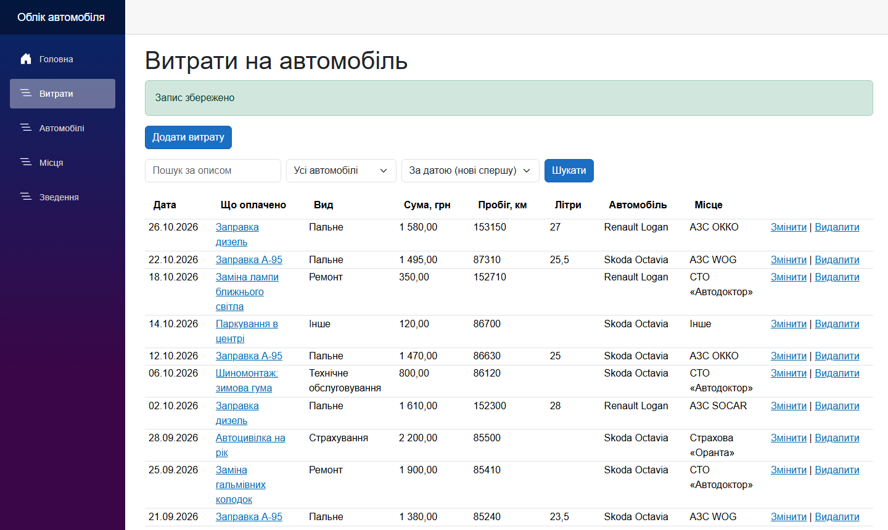
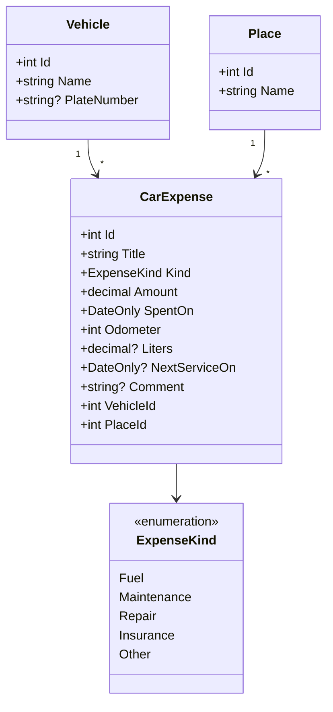
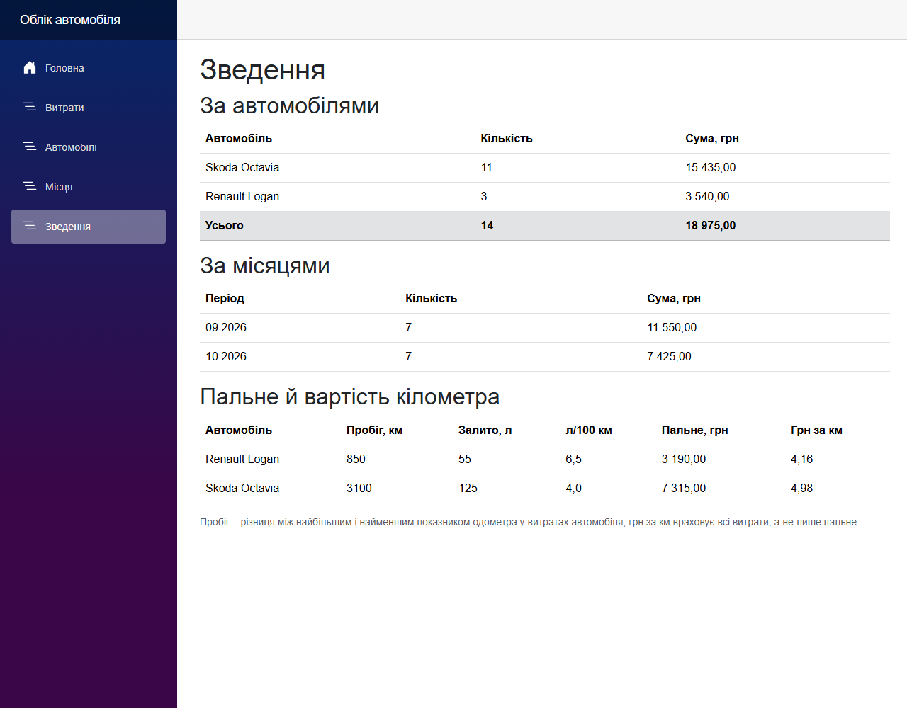
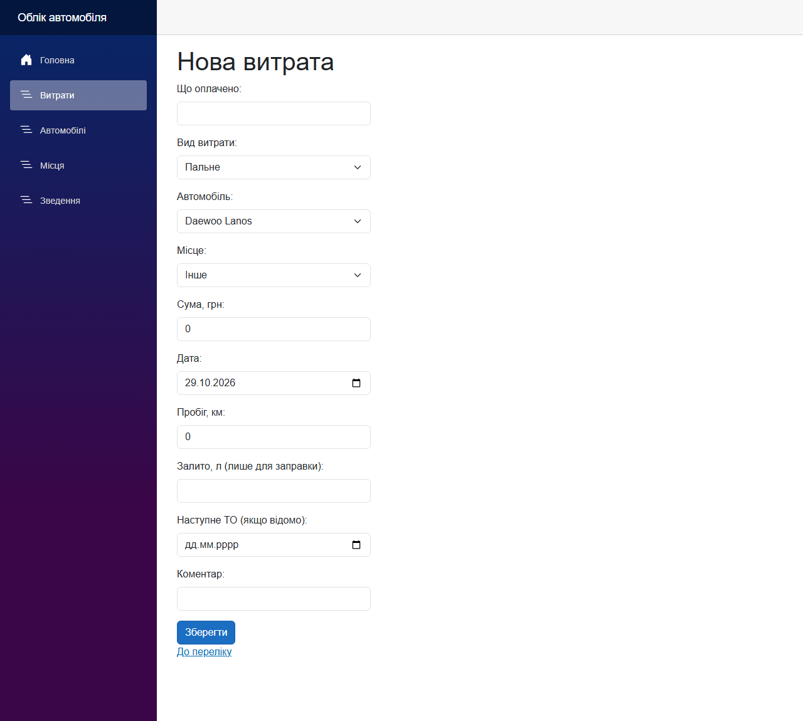
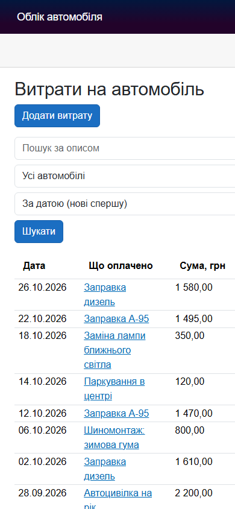

# CarExpenses — Облік автомобіля

**Тема проєкту:** «Облік автомобіля: заправки, обслуговування, витрати; витрата пального та вартість поїздки» (додаток А, тема № 14).

Вебзастосунок для власника автомобіля. Він веде облік заправок, обслуговування та інших витрат на машину й показує, скільки пального вона витрачає на 100 км і у що обходиться поїздка. Застосунок допомагає планувати витрати й не пропускати чергове обслуговування.



**Технології:** .NET 10, Blazor Web App зі статичним відтворенням на сервері (`--interactivity None`), Entity Framework Core і SQLite, QuickGrid, Bootstrap.

## Модель предметної області

Основний тип — `CarExpense` (витрата на автомобіль):

| Властивість | Тип | Зміст |
|---|---|---|
| `Id` | `int` | первинний ключ |
| `Title` | `string` | що саме оплачено (обов’язкова) |
| `Kind` | `ExpenseKind` | вид витрати: пальне, ТО, ремонт, страховка, інше |
| `Amount` | `decimal` | сума, грн |
| `SpentOn` | `DateOnly` | дата витрати |
| `Odometer` | `int` | пробіг на момент витрати, км |
| `Liters` | `decimal?` | залито літрів (лише для заправки) |
| `NextServiceOn` | `DateOnly?` | дата наступного ТО, якщо відома |
| `Comment` | `string?` | коментар |
| `VehicleId` / `Vehicle` | `int` / `Vehicle` | автомобіль (довідник) |
| `PlaceId` / `Place` | `int` / `Place` | місце: АЗС, СТО, мийка… (довідник) |

### Діаграма класів



## Особливість проєкту

**Експорт звіту у файл CSV.** Користувач завантажує всі витрати (або відібрані пошуком) одним файлом із роздільниками: дата, вид, опис, сума, пробіг, літри. Такий файл відкривається в Excel чи Google Таблицях, тож звіт про утримання машини можна передати іншим, порахувати своє або зберегти як архів. Генератор сторінок такого не створює: потрібно сформувати текст файлу й віддати його браузеру для завантаження.

## Знімки екрана

| Зведення | Нова витрата | Телефон |
|---|---|---|
|  |  |  |

## Вебсервіс

| Адреса | Що повертає |
|---|---|
| `GET /api/carexpenses` | усі витрати у форматі JSON, нові спершу |
| `GET /api/carexpenses/{id}` | одну витрату; 404, якщо такої немає |
| `GET /api/summary` | зведення за автомобілями: кількість і сума витрат |
| `GET /export/carexpenses.csv?search=…&vehicleId=…` | звіт у CSV (особливість проєкту); те саме дає кнопка «Завантажити CSV» на сторінці витрат |

Опис інтерфейсу OpenAPI: `/openapi/v1.json`, сторінка перегляду — `/scalar` (лише в середовищі Development). Приклади запитів — у файлі `CarExpenses/CarExpenses.http`.

## Як запустити

Потрібен .NET SDK 10.

```
cd CarExpenses
dotnet run
```

Застосунок відкривається за адресою http://localhost:5185 (порт записано в `CarExpenses/Properties/launchSettings.json`).
