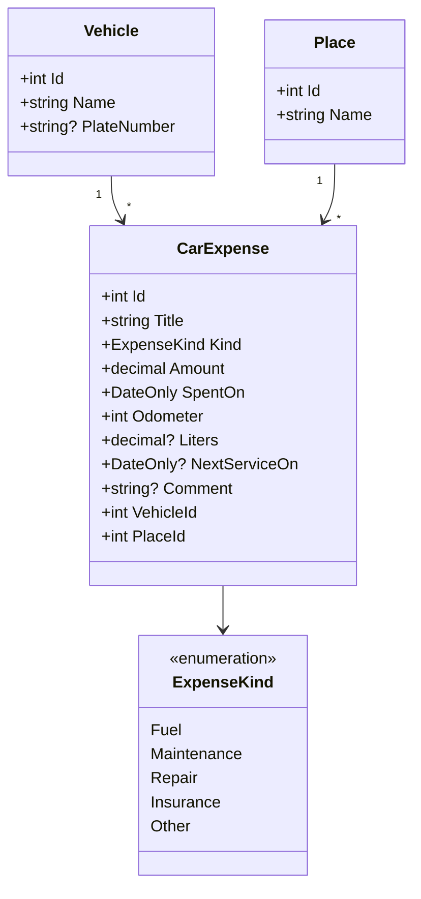

# CarExpenses — Облік автомобіля

**Тема проєкту:** «Облік автомобіля: заправки, обслуговування, витрати; витрата пального та вартість поїздки» (додаток А, тема № 14).

Вебзастосунок для власника автомобіля. Він веде облік заправок, обслуговування та інших витрат на машину й показує, скільки пального вона витрачає на 100 км і у що обходиться поїздка. Застосунок допомагає планувати витрати й не пропускати чергове обслуговування.


**Технології:** .NET 10, Blazor Web App зі статичним відтворенням на сервері (`--interactivity None`), Entity Framework Core і SQLite, QuickGrid, Bootstrap.

## Модель предметної області

Основний тип — `CarExpense` (витрата на автомобіль):

| Властивість | Тип | Зміст |
|---|---|---|
| `Id` | `int` | первинний ключ |
| `Title` | `string` | що саме оплачено (обов’язкова) |
| `Kind` | `ExpenseKind` | вид витрати: пальне, ТО, ремонт, страховка, інше |
| `Amount` | `decimal` | сума, грн |
| `SpentOn` | `DateOnly` | дата витрати |
| `Odometer` | `int` | пробіг на момент витрати, км |
| `Liters` | `decimal?` | залито літрів (лише для заправки) |
| `NextServiceOn` | `DateOnly?` | дата наступного ТО, якщо відома |
| `Comment` | `string?` | коментар |
| `VehicleId` / `Vehicle` | `int` / `Vehicle` | автомобіль (довідник) |
| `PlaceId` / `Place` | `int` / `Place` | місце: АЗС, СТО, мийка… (довідник) |

### Діаграма класів



## Особливість проєкту

**Експорт звіту у файл CSV.** Користувач завантажує всі витрати (або відібрані пошуком) одним файлом із роздільниками: дата, вид, опис, сума, пробіг, літри. Такий файл відкривається в Excel чи Google Таблицях, тож звіт про утримання машини можна передати іншим, порахувати своє або зберегти як архів. Генератор сторінок такого не створює: потрібно сформувати текст файлу й віддати його браузеру для завантаження.

## Знімки екрана

| Зведення | Нова витрата | Телефон |
|---|---|---|
|  |  |  |

## Вебсервіс

| Адреса | Що повертає |
|---|---|
| `GET /api/carexpenses` | усі витрати у форматі JSON, нові спершу |
| `GET /api/carexpenses/{id}` | одну витрату; 404, якщо такої немає |
| `GET /api/summary` | зведення за автомобілями: кількість і сума витрат |
| `GET /export/carexpenses.csv?search=…&vehicleId=…` | звіт у CSV (особливість проєкту); те саме дає кнопка «Завантажити CSV» на сторінці витрат |

Опис інтерфейсу OpenAPI: `/openapi/v1.json`, сторінка перегляду — `/scalar` (лише в середовищі Development). Приклади запитів — у файлі `CarExpenses/CarExpenses.http`.

## Як запустити

Потрібен **.NET SDK 10** (https://dotnet.microsoft.com/download). Окремий сервер бази даних не потрібен: SQLite — це один файл, а міграції застосунок виконує сам під час запуску.

```
git clone https://github.com/Taraskokorin/1lab.git
cd 1lab/CarExpenses
dotnet run
```

У консолі з'явиться адреса, наприклад `http://localhost:5185`. Відкрийте її в браузері. Під час першого запуску поруч створюється порожня база `carexpenses.db`; додайте автомобіль і місце (меню «Автомобілі», «Місця»), а потім першу витрату.

Тести запускають з кореневого каталогу:

```
cd 1lab
dotnet test
```

## Налаштування

У `CarExpenses/appsettings.json`:
- `ConnectionStrings:Default` — рядок підключення до SQLite;
- `CarExpenses:PageSize` — скільки витрат показувати на сторінці;
- `CarExpenses:Title` — назва застосунку в меню.

У середовищі Production (`ASPNETCORE_ENVIRONMENT=Production`) сторінка помилки не показує подробиць, а опис OpenAPI й `/scalar` вимкнено.

## Опублікована збірка

```
cd CarExpenses
dotnet publish -c Release -o ../publish
cd ../publish
dotnet CarExpenses.dll
```

Застосунок відкривається на `http://localhost:5000` і створює власну порожню базу.

## Контейнер

Docker на машині розробника не встановлено, тому образ не збирався. Нижче описано порядок, за яким його створює .NET SDK без Dockerfile:

```
cd CarExpenses
dotnet publish -c Release --os linux --arch x64 -p:ContainerImageTag=latest /t:PublishContainer
docker volume create carexpenses-data
docker run --rm -p 8080:8080 -v carexpenses-data:/home/app/data -e ConnectionStrings__Default="Data Source=/home/app/data/carexpenses.db" carexpenses:latest
```

- Перша команда створює образ `carexpenses:latest` (назва — від назви збірки в нижньому регістрі; порт 8080).
- База лежить у томі `carexpenses-data`, тож записи переживають перезапуск контейнера (`--rm` видаляє лише сам контейнер).
- Шлях до бази задано змінною середовища (`ConnectionStrings__Default` = розділ `ConnectionStrings`, ключ `Default`), бо в образі застосунок працює від імені користувача `app` і писати може лише у `/home/app`.
- Міграції виконує сам застосунок, бо засобу `dotnet ef` в образі немає.
- Якщо контейнер повідомляє «unable to open database file», додайте до `docker run` параметр `--user root` (каталог тому створено від імені root).
- Застосунок відкривається на `http://localhost:8080`. HTTPS-перенаправлення ввімкнене лише в Development, тому в контейнері сторінка відкривається звичайним `http`.

Автор: Кокорін Тарас, група 33 Бд-СОінф.
